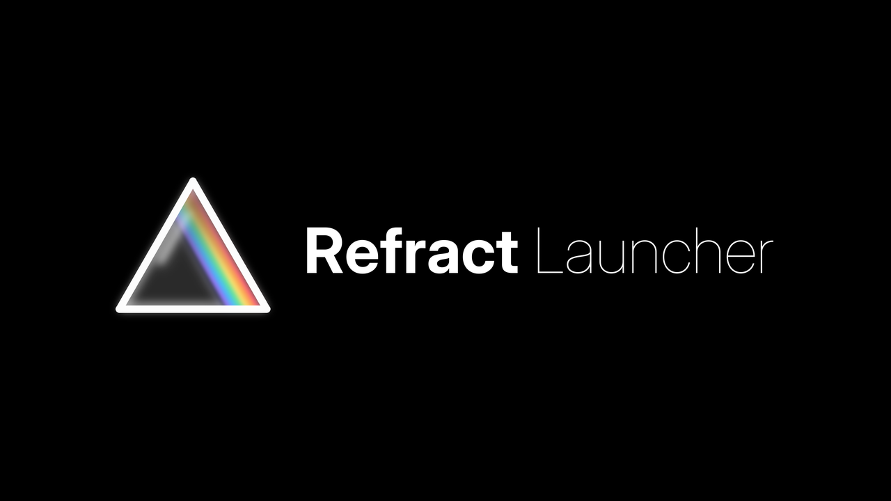
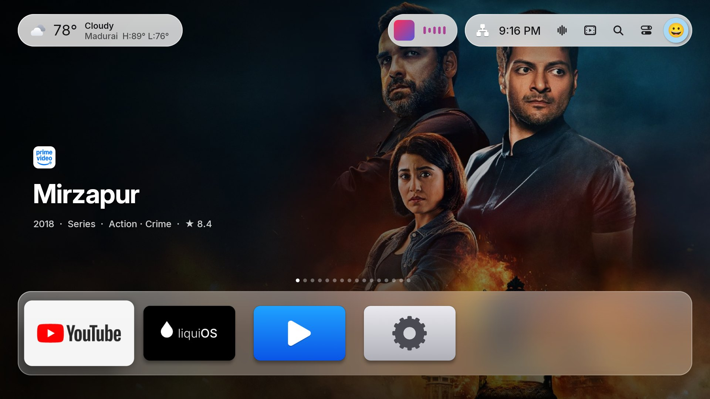
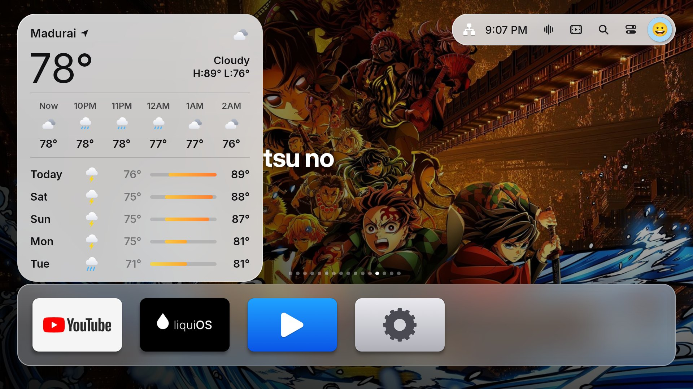
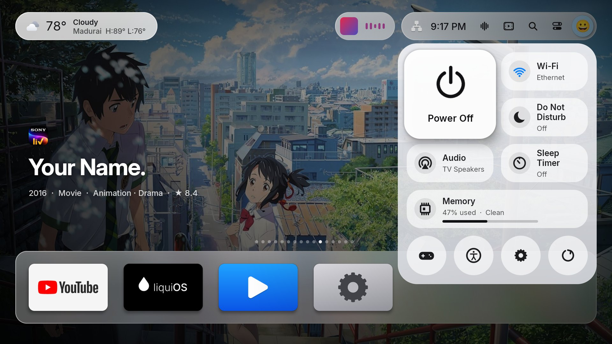
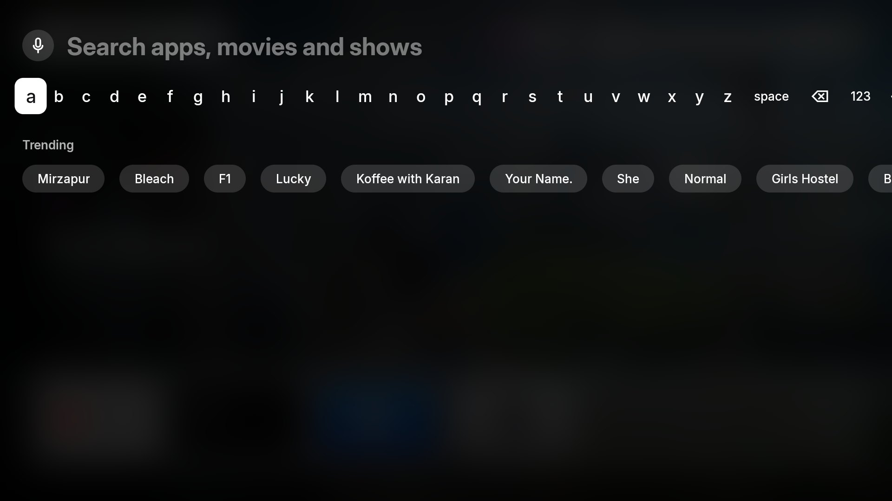
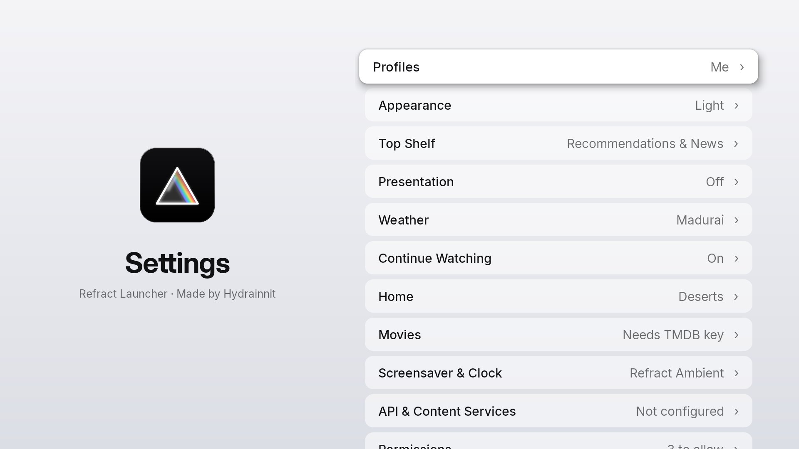
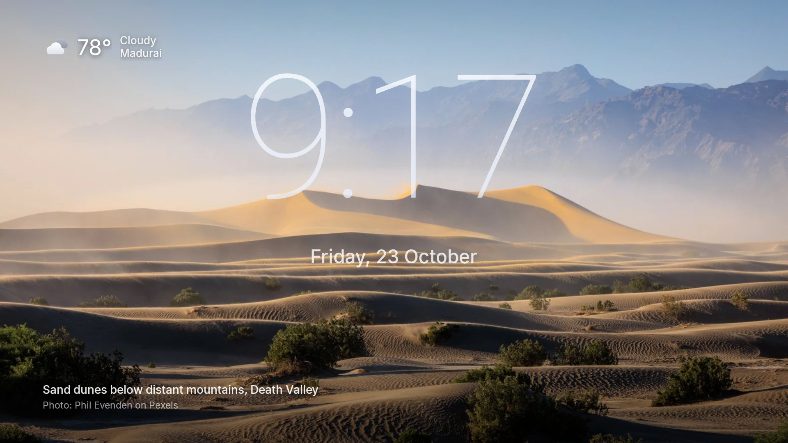
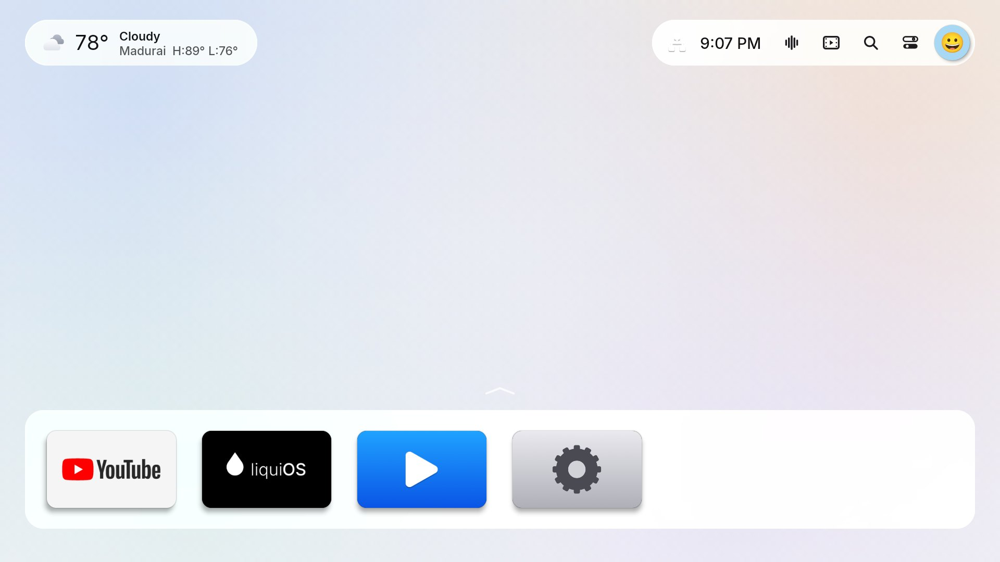
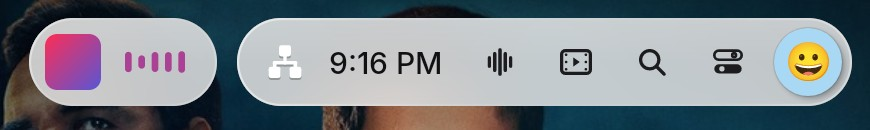

# Refract Launcher



A tvOS 26–style home screen for Android TV, **made by Hydrainnit**. It is a fork of
[Hume Launcher](https://github.com/petrobot-admin/hume-launcher) by **Petrobot**, whose work it
builds on (see [Attributions](ATTRIBUTIONS.md)). It replaces the stock launcher with one modelled on
Apple TV: glass dock, full-screen carousel, Control Center and profiles. It is built to stay smooth
on low-end TV boxes like the Xiaomi Mi Box. Plain Java, no Gradle, no third-party runtime
libraries. The APK is about 4 MB, 2.6 MB of which is bundled photographs.

Application ID: `com.hydrainnit.refract`.



## Screenshots

| | |
|---|---|
|  |  |
| **Weather**: focus the pill and it grows into a forecast card | **Control Center**: one glass panel |
|  |  |
| **Search**: apps, settings and every streaming service | **Settings**, tvOS-style |
|  |  |
| **Refract Ambient** screensaver with weather and photo credit | **Light appearance** |



*Now Playing: album art and a waveform beside the status pill while music plays in the background.*

Screenshots are from the Android TV emulator. Posters and artwork shown in the carousel belong to
their studios and are fetched at runtime, not shipped in the app.

## Features

- **Appearance**: Light (frosted white glass, dark text) or Dark (smoked glass), chosen in setup
  with live previews and followed by every screen.
- **Home**: Liquid Glass dock, 6-across app grid in Apple's measured proportions, focus lift and
  zoom-to-open, More Apps folder, 18 bundled Pexels photographs in 9 categories shown behind the
  grid.
- **Movies**: a Movies tab (Trending, Popular, Top Rated, Coming Soon, genres) and an optional
  **Movies Home Theme** with full-screen TMDB backdrops, title logos, rating, release date and
  overview. Both need your own free TMDB key.
- **Refract Ambient**: a photo or movie screensaver with a glass-gradient clock (6 styles), weather
  and photo credits, usable on idle Home or as the TV's own screensaver.
- **Carousel**: Continue Watching first (Resume / Remove, expires after 7 days), then Indian news
  (India, your city, world) and rotating recommendations from your streaming services. Goes full
  screen when Home is idle.
- **Status pill**: internet indicator, time, voice assistant, Movies, Search, Control Center,
  profile avatar. The remote's voice/mic button opens the same voice flow.
- **Now Playing**: while Spotify, Amazon Music, YouTube or any app plays in the background, a glass
  pill with the album art and a waveform appears beside the status pill (Dynamic Island-style).
- **Search**: apps, settings and inputs instantly, plus movies and shows on every streaming service
  in India (Indian titles included, typed in English or Hindi, or spoken) with **Open** in the app
  you have or **Get** for the one you don't.
- **Weather**: a glass pill level with the status pill that grows into an Apple Weather-style card
  on focus: hourly row and 5-day range bars (Open-Meteo, MET Norway or wttr.in — no keys).
- **Control Center**: one glass panel with Power Off, Wi-Fi, Do Not Disturb, audio, sleep timer,
  Memory/Clean, and round shortcuts (controllers, accessibility or inputs, settings, refresh).
- **API keys**: optional TMDB and Pexels keys, entered on the TV and stored encrypted with the
  Android Keystore. Never required.
- **Profiles**: up to 3, each with its own layout, background and carousel; full-screen switcher.
- **Inputs**: HDMI/AV/TV picker with connector icons, on TVs that have inputs.
- **Presentation mode**: send images, videos and webpages from a browser and loop them full screen;
  can start with the TV (signage).
- **First-time setup** in Apple's style, **multi-page Settings**, permissions asked **on screen**
  (adb only as a last resort), system or carousel **screensaver**, and Android TV navigation sounds.
- **AirPlay**: works with the open-source [AirPlay Server](https://github.com/jqssun/android-airplay-server)
  app; Refract keeps the receiver visible to Macs and iPhones after the TV sleeps.

Full list with screenshots: **[docs/features.md](docs/features.md)**.

## Quick start

```sh
# needs JDK 17+ and Android SDK build-tools 34.0.0 + platform android-34 (see getting started)
./build.sh                                   # → build/refract-launcher.apk
adb connect <tv-ip>:5555
adb install -r build/refract-launcher.apk
adb shell am start -n com.hydrainnit.refract/.MainActivity
```

## Documentation

| | |
|---|---|
| **[Getting started](docs/getting-started.md)** | Install the tools, build, run on a TV or the emulator, developer shortcuts |
| **[Features](docs/features.md)** | Everything Refract does, by area |
| **[Install and set up](docs/install.md)** | Make it the home screen, permissions, undo |
| **[Presentation mode](docs/presentation.md)** | Sending content from a browser, the player, the web API |
| **[Architecture](docs/architecture.md)** | Code map, build, design decisions, performance |
| **[Attributions](ATTRIBUTIONS.md)** | Original app, fonts, code, photographers, data sources |
| **[Contributing](CONTRIBUTING.md)** | Workflow, code style, design and performance rules, testing, pull requests |

## Requirements

Android TV 7.0+ (API 24). Developed and tested on a Xiaomi Mi Box 4 (Android 12) and an Android 9
TV with 1 GB RAM.

## License

Apache License 2.0 — see [LICENSE](LICENSE) and [NOTICE](NOTICE).

## Credits

Refract Launcher is made by **Hydrainnit**, on top of other people's work. Thank you to all of them.
The full list, with licences and links, is in **[ATTRIBUTIONS.md](ATTRIBUTIONS.md)** and on the TV
under Settings → About → Attributions.

- **Original app**: [Hume Launcher](https://github.com/petrobot-admin/hume-launcher) by
  **Petrobot** (Apache 2.0). Refract is a fork; the original licence and NOTICE are kept.
- **Fonts**: [Inter and Inter Display](https://rsms.me/inter/) by The Inter Project Authors (SIL OFL 1.1).
- **Code**: [QR Code generator](https://www.nayuki.io/page/qr-code-generator-library) by Project Nayuki (MIT).
- **Photographs** ([Pexels](https://www.pexels.com), Pexels License): Sophia Zheng, Magic K, Phil
  Evenden, Mo Eid, Marc Coenen, Atlantic Ambience, Ali Kazal, Beepin4, Vijit Bagh, Pixabay, İrem
  Kızılarslan, Dominik Perau, Codioful (formerly Gradienta), S S, Aarin Husain, Septimiu Lupea and
  Sergio Zhukov.
- **Data**: [TMDB](https://www.themoviedb.org) (*this product uses the TMDB API but is not endorsed
  or certified by TMDB*), [JustWatch](https://www.justwatch.com), [Open-Meteo](https://open-meteo.com)
  and [MET Norway](https://api.met.no) (CC BY 4.0), [wttr.in](https://wttr.in) by Igor Chubin,
  Stremio Cinemeta, and the RSS feeds of Indian newsrooms (headlines belong to their publishers).
- **Works with**: [AirPlay Server](https://github.com/jqssun/android-airplay-server) by jqssun.
